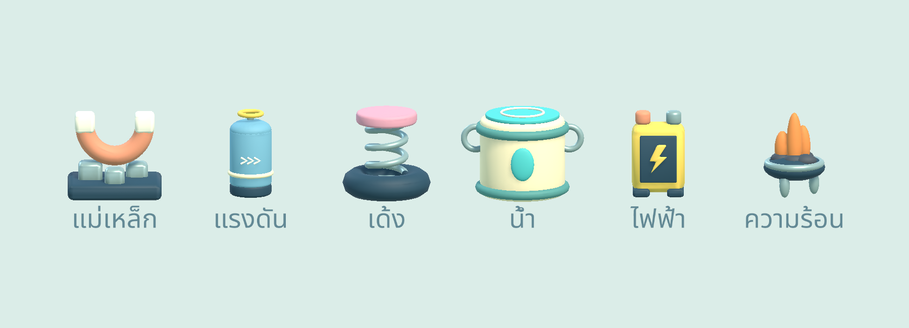
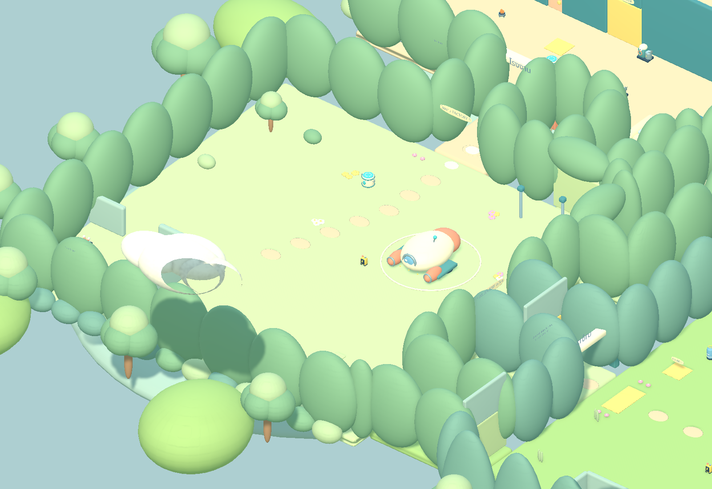
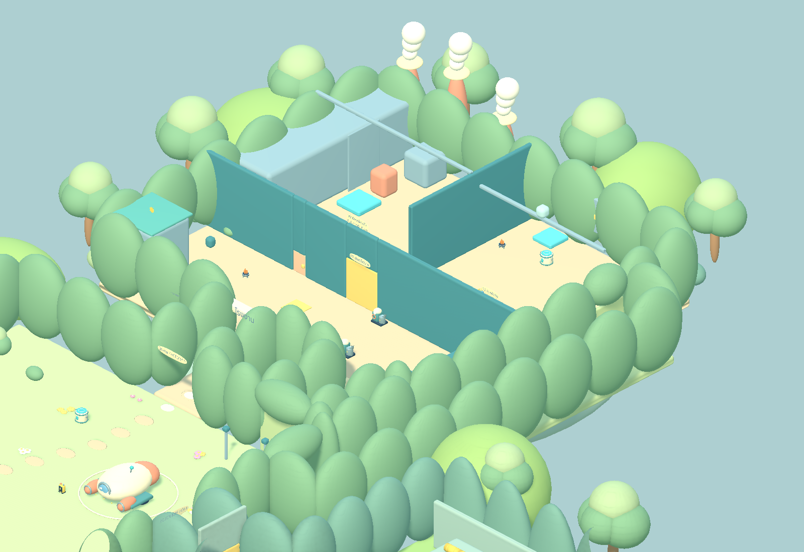
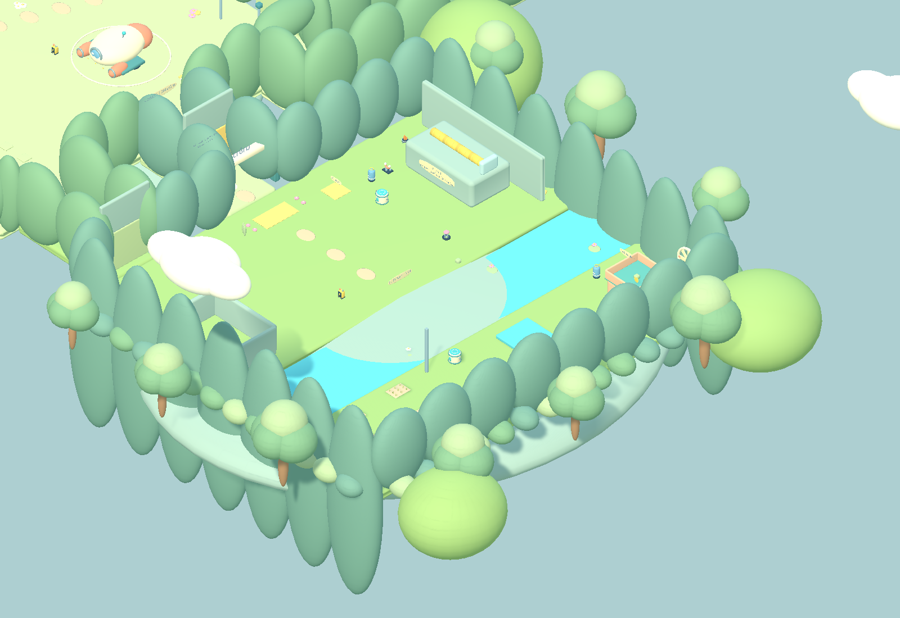
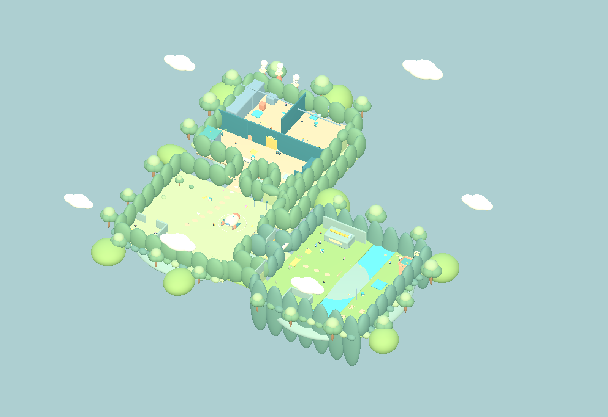
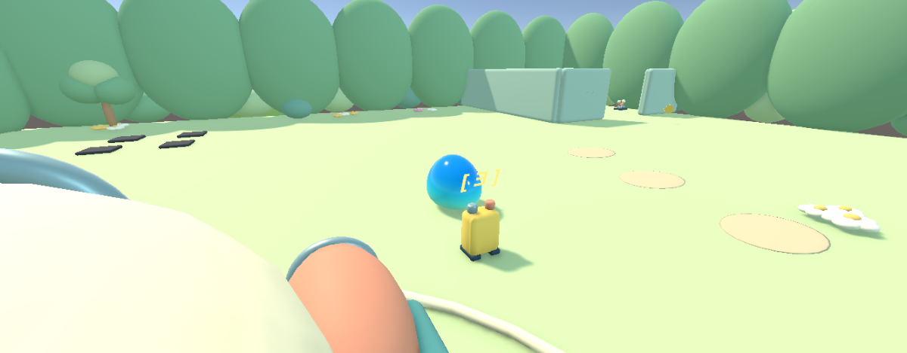

# งานแมพและโมเดลรอบ Pino — 2026-10-23

ขอบเขตที่เจ้าของอนุมัติ: ใช้ Pino และโมเดลเดิมเป็น reference ปรับทั้งแมพ โดยคงแนวกลมมนแบบ Kirby ของรอบก่อน และอนุญาตหยุด Unity เพื่อทำงาน/ทดสอบ

## สิ่งที่เปลี่ยน

- ฉากหลัก `Assets/Scenes/OopsPlanet/Scenes/OopsPlanet_V2.unity` ใช้ Pino เป็นตัวละครที่มองเห็น โดยคงตัวควบคุมผู้เล่นเดิม
- สร้าง Blender models ใหม่ 12 ชุด: ของดูดได้ 6 ธาตุ, ปั๊ม, หม้อต้ม, กรอบกังหัน, ยานแคปซูล, แปลงข้าว และของตกแต่งทางเข้า/ลานจอด
- ของดูดได้ 34 จุดใช้ silhouette ตามชนิด: แม่เหล็กตัวยู, ถังแรงดัน, สปริง, ถังน้ำ, แบตเตอรี่ และเตาความร้อน มีสีซีดลงหลังดูดและคืนสภาพตามระบบเดิม
- ปรับสีพื้น/ต้นไม้ให้อ่อนลง เพิ่มซุ้มโรงงานและนาข้าว พร้อมลานยานที่ Hub
- เปลี่ยนชิ้นส่วนยานจากก้อนเดิมเป็นเฟือง และผูกการแสดงผลเข้ากับการเก็บชิ้นส่วน
- ไฮไลต์วัตถุขยายเฉพาะโมเดลภาพ เพื่อไม่ให้ขนาด collider ของแหล่งพลังเปลี่ยนระหว่างเล็ง
- วัสดุที่มีแสงเปล่งออกจะดับ emission เมื่อแหล่งพลังถูกใช้แล้ว
- ย้าย `Rice west Magnet source (scrap)` จาก `(39.5,3,14.5)` ไป `(37,0,12)` ข้างแท่น R1 เพราะตำแหน่งเดิมขวางช่องระบายฟางเมื่อ collider มีขนาดคงที่ตามที่ออกแบบ ทั้ง Apply และ builder ใช้ตำแหน่งใหม่
- กด Apply ซ้ำสองครั้งและเปิดฉากใหม่แล้ว ตรวจขนาดของโมเดลแหล่งพลังครบ 34 จุด ใช้ความสูงที่แน่นอนแทน `Renderer.bounds` ของ mesh เก่าที่ปิดการแสดงผลอยู่

## ไฟล์และการสร้างซ้ำ

- Blender: `ArtSource/Blender/OOPS_WorldPolish.blend`
- Generator: `ArtSource/Blender/build_world_polish.py`
- FBX/manifest: `Assets/Scenes/OopsPlanet/Models/WorldPolish/`
- วัสดุ: `Assets/Scenes/OopsPlanet/Materials/WorldPolish/`
- การผูกภาพเข้าฉาก: `Assets/Scenes/OopsPlanet/Editor/WorldPolishArt.cs`
- เมนู: **Tools → OOPS Planet → V2 → Apply Full World Polish**
- V2 builder เรียก WorldPolishArt หลัง SoftWorldArt และการตั้งค่า 15 คอมโบ เพื่อสร้างซ้ำได้
- แก้ output path ของ generator Soft World ให้ตรงโฟลเดอร์ใหม่ `Assets/Scenes/OopsPlanet/`

โมเดลใหม่รวม 88,964 triangles ก่อน Unity import ใช้วัสดุร่วมตามบทบาทสี ไม่มี collider เพิ่มให้ของตกแต่ง ส่วนปริศนาใช้ root/collider/trigger เดิม

## การทดสอบ

Campaign V2 กับ Pino: **49/49 ผ่าน**, ใช้คอมโบครบ **15/15**, เล่นถึงจบและเซฟ/โหลดผ่าน, settled state mismatch **0** (request `0b29efad9a0b4c7b9bde262d5a064e38`, จบ 2026-10-23T16:19:53Z)

รายงาน:
- `Assets/Scenes/OopsPlanet/Evidence/world-polish-v2-test.json`
- `Assets/Scenes/OopsPlanet/Evidence/world-polish-pino-test.json`

EditMode: **14/14 ผ่าน** (`b3d9c7811b7944dea7339bf4fa2d1e88`)

รอบ campaign แรกผ่าน 48/49 ติดการผลักฟางที่กองเหล็กขวางทาง แก้ตำแหน่งแล้วเคสเดิมผ่านในรอบใหม่ เงื่อนไข/จำนวนครั้งใน test เดิมไม่ถูกลดลง

Smoke test ดูดวัตถุจริงทั้ง 6 ชนิดและเก็บชิ้นส่วนยาน: **27/27 ผ่าน** หลังบันทึกและเปิดฉากใหม่ ครอบคลุมการเล็ง การดูดด้วย input E การไม่เปลี่ยนขนาด collider ตอน highlight การคืนสภาพ และโมเดลเฟืองหาย/กลับมาตามการเก็บและ reset

รายงาน: `Assets/Scenes/OopsPlanet/Evidence/world-art-smoke.json`

ฉากสุดท้ายหลังเปิดใหม่: Pino อยู่ในฉากหลัก, แหล่งพลัง 34 จุด, ชิ้นส่วนยาน 15 ชิ้นอ้างถึงเฟืองใหม่ และ collider ใต้โมเดลใหม่ **0**

การทดสอบใช้ save slot แยกและลบ slot หลังจบ ไม่ใช้เซฟจริงของผู้เล่น

## ภาพจาก Unity

## ข้อจำกัด

- เป็น art pass ของแผนผัง V2 เดิม ไม่ได้เพิ่มห้องหรือเปลี่ยนเงื่อนไขปริศนา
- Pino ร่าง Heat/Electric ยังใช้รูปทรงปกติร่วมกับสี/เอฟเฟกต์ของพลังตามการเชื่อมระบบเดิม
- ยังไม่มี standalone build รอบนี้ และยังไม่ commit/push งานรอบนี้
- Build Settings ยังเป็นค่าที่เจ้าของตั้งไว้เดิม

สำรองก่อนทำ: `E:/!for WORK/GPT/AFO_before_Vrzo_20261023_222908.zip`
